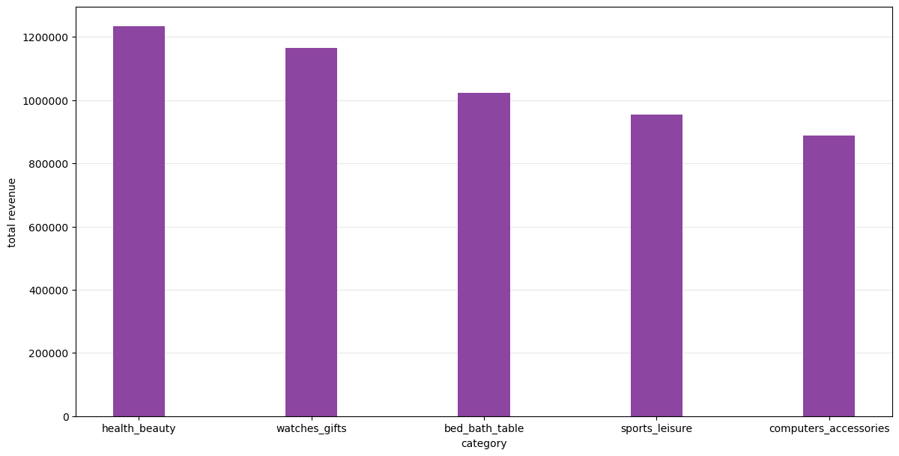
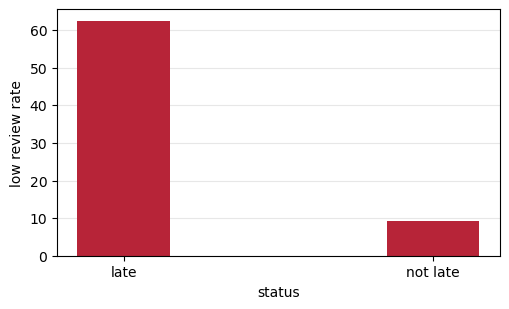
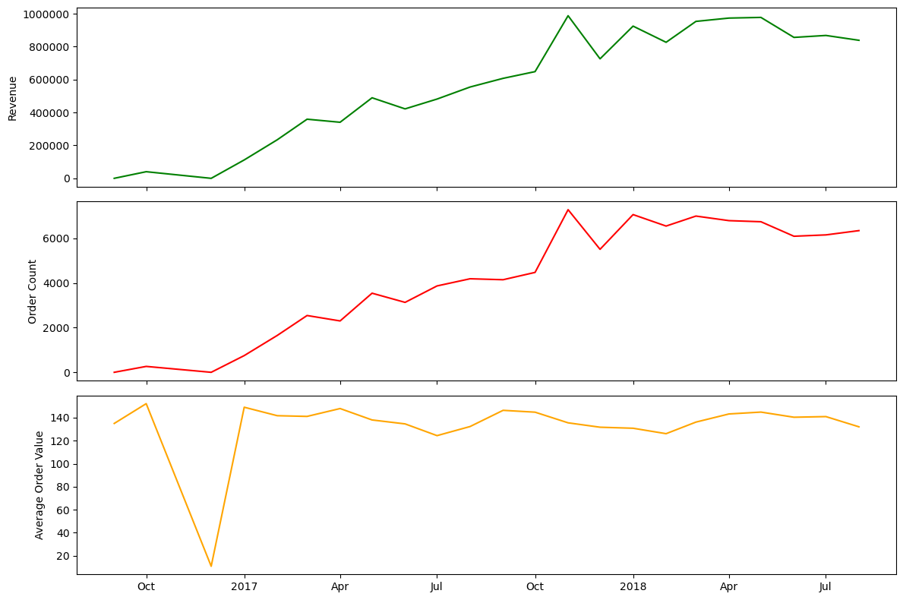

## Revenue By Category

In this part we will analyze which product categories generate the most revenue.

[SQL](../sql/02_category_revenue.sql) |
[Notebook](../notebooks/03_category_revenue.ipynb)

**Notes:** 
- To evaluate the most productive categories, I have queried the `total_revenue`, the `average_revenue` and the `median_revenue` for the products of each categories
- Only __delivered__ orders are considered
- We don't take `freight_value` into account

**Important limitation:** For this analysis I have equated the __price__ to the __revenue__ generated by one product.

**Observations:**
- top 5 highest total revenue are: __health_beauty__, __watches_gifts__, __bed_bath_table__, __sports_leisure__ and __computers_accessories__; All of these categories have high product counts - position 2 __watches_gifts__ having the smallest `product_count` within this list yet still only __1691__ monetary units appart from the top value; `average_price`s are not unusual compared to the other items; These categories also have a high number of `units_sold` (no. 3 has maximum value of units sold - __10953__) but they don't necessarly have all of the highest values; For example no. 2 __watches_gifts__ has the lowest number of `units_sold` __5859__ while having the highest `average_price` __339.08__;
- top 5 highest average revenue per product are: __computers__, __small_appliances_home_oven_and_coffee__, __home_appliances_2__, __agro_industry_and_commerce__ and __watches_gifts__; Based on `product_count` we can observe that this a high product ariety isn't necessary for this category to generate revenue however the `average_price` of a product within the category is slightly higher, with the top one entry having the highest average price per product by a large margin (1003.95 monetary units, second spot being at 415.70 monetary units, and second biggest `average_price` being 501.38 - this occupies 3rd spot whithin this list); The amount of `units_sold` is also lower using this metric, all of the entries having a total amount of units sold under __240__, except the 5th entry __watches_gifts__ which has 5859 units; This suggests that `average_revenue` tends toward categories with high prices;
- top 5 highest median revenue per product are: __computers__, __cds_dvds_musicals__, __home_appliances_2__, __tablets_printing_image__ and __office_furniture__; Categories with very small product counts can produce misleading median rankings because the median is based on too few observations; For example __cds_dvds_musicals__ occupies second spot while having a __total_revenue__ of only __730.00__ monetary units total and a `product_count` of __1__; __tablets_printing_image__ ocuppies 4th spot despite having one of the weaker `total_revenue`s of __752841__ monetary units and a `product_count` of 9; Some categories rank highly despite low product variations or a low amount of units sold; Therefore this metric should be used with caution;

**Conclusion:** The highest-total-revenue categories generally combine substantial sales volume with sufficiently high prices, while categories ranking highly on average or median revenue per product are often much smaller and therefore contribute less to overall business revenue.

## Orders with multiple reviews

[Review Data Quality Queries](../sql/03_review_data_quality.sql)

**Data issue discovered:** One order can have multiple reviews. The reason is not explained on the dataset's page.

**Findings:** For these findings I have analysed two orders with each with two reviews:
- order with `order_id` b9a528ec4ad891d009b3dc50588218f1 two review records with the same score were submitted approximately one minute appart to the same survey;
- order with `order_id` 6318d8c5f6857de384c0b3186d036457 illustrates a case in which the user gave a poor review of score 3 the first time and after receiving a second survey approximately 10 days later he gave a score of 5;
- there are __98673__ reviewed orders in total and __547__ of them have duplicate reviews - __0.5%__;

**Conclusion:** These examples suggest that later reviews may represent updated customer feedback. Because duplicate-review orders represent only about 0.5% of reviewed orders, the choice of canonical-review rule is unlikely to materially affect aggregate results.

## Review score - subsequent purchasing

[Review Sales Association Queries](../sql/04_review_score_future_spending.sql)

For this analysis we want to check whether a whether good (or bad) reviews corelate with more (or less) future purchases from a given customer. We take into consideration the first ever order a customer reviews and then check whether they make a purchase, only after that review was submited and within 90 days of that review. (As explained earlier, in case of orders with multiple reviews, the last review is considered to reflect the customer's opinion)

**Observation:** Because the review applies to the entire order, it is interpreted as an overall purchase-experience measure rather than a product-specific rating.

**Limitation:** Customers whose first reviewed order occurs near the end of the dataset have less than 90 days of observable follow-up time. Therefore, repeat-purchase rates may be slightly underestimated for those customers.

[Query results](../runs/04_review_score_future_spending.csv)

| Review Score | Customers | Repeat Customers | Repeat Rate (%) |
|---:|---:|---:|---:|
| 1 | 10,999 | 103 | 0.94 |
| 2 | 3,036 | 33 | 1.09 |
| 3 | 7,864 | 82 | 1.04 |
| 4 | 18,493 | 154 | 0.83 |
| 5 | 54,988 | 551 | 1.00 |

**Findings:**
- most customers do not make a subsequent purchase within 90 days of their first reviewed order;
- `review_score`s of __4__ have the lowest subsequent purchasing rate at __0.83%__ and for `review_score`s __1, 2, 3 and 5__ the subsequent purchasing rate is approximately __1%__ for all;

**Conclusion:** The 90-day repeat-purchase rate remains approximately 1% across all review scores, with no clear monotonic relationship between review score and subsequent purchasing. Review score therefore does not appear to be a strong predictor of short-term repeat purchasing in this dataset.

# Freight value - review score

[Freight Value Review Score Assocation](../sql/05_freight_value_review_score.sql)

This analysis looks into finding a corelation between the review an order receives and its freight value.

[Query results](../runs/05_freight_value_review_score.csv)

| Review Score | Order Count | Median Freight | Average Freight | Median Order Value | Median Freight Burden |
|---:|---:|---:|---:|---:|---:|
| 1 | 11,363 | 18.44 | 27.74 | 120.60 | 0.186 |
| 2 | 3,131 | 18.00 | 26.24 | 112.35 | 0.191 |
| 3 | 8,133 | 17.63 | 23.54 | 103.26 | 0.192 |
| 4 | 19,038 | 17.19 | 22.38 | 102.85 | 0.184 |
| 5 | 57,008 | 16.79 | 21.72 | 103.27 | 0.181 |

**Findings:** 
- total order values are sligtly higher at lower `review_scores` also resulting in higher freght values, however freight burden doesn't have a predictable evolution between scores;
- overall the analysis shows an inverse evolution between `freight_value`s and `review_score`s, though the price differences are very small (less than 1 currency points- based on `median_freight`)

**Conclusion**: Lower review scores are associated with somewhat higher absolute freight costs. However, lower-rated orders also tend to have higher order values, while freight burden varies only slightly and does not follow a consistent pattern across review scores. Therefore, freight cost alone does not appear to be a strong driver of review score.

# Delivery delays - review score

This section wants to explore whether there is a pattern between late deliveries and low review scores.

[SQL](../sql/07_delivery_estimation_review_score.sql) |
[Notebook](../notebooks/07_delivery_estimation_review_score.ipynb)

| delivery_status | order_count | average_review_score | low_review_rate |
|---|---:|---:|---:|
| late | 6,385 | 2.27 | 62.38% |
| not late | 89,445 | 4.29 | 9.27% |

**Notes:** 
- a late delivery is considered to have __at least one day__ delay; 
- `low_review_rate` means out of total reviews for that status, what percentage of them have a `review_score` of __2 or lower__;

| review_score | order_count | median_delay | average_delay |
|---:|---:|---:|---:|
| 1 | 3431 | 9.00 | 13.05 |
| 2 | 552 | 7.88 | 10.88 |
| 3 | 695 | 5.77 | 9.74 |
| 4 | 650 | 3.545 | 9.04 |
| 5 | 1057 | 3.62 | 7.64 |

**Findings:**
- out of the orders which have received a review, __6.66%__ were late; Orders with late deliveries received an `average_review_score` of __2.27__ and a `low_review_rate` of __62.38%__;
- meanwhile, for orders which were not late, the `average_review_score` was __4.29__ and the `low_review_rate` was __9.27%__;
- furthermore, we can see that the review score has a negative relationship with the delay an order had; The median delay for an order of score __1__ was __9 days__, score __2__ - __7.88 days__, score __3__ - __5.77 days__ and scores __4__ and __5__ for orders with delays around __3.5 days__;

**Conclusion:** Late deliveries are strongly associated with lower review scores. This suggests delivery performance is strongly related to customer satisfaction.

## Revenue Over Time

In this part we want to analyze whether revenue increase is driven by an increased number of orders or an increase of order values.

[SQL Query](../sql/08_revenue_over_time.sql) | 
[Notebook](../notebooks/08_revenue_over_time.ipynb)

**Notes:**
- the data is spread throughout 2 years from september 2016 till august 2018;
- the first three months show unstable activity and are treated as a ramp-up period; therefore I suggest studying the evolution of revenue from january 2017 when the business seems to have taken off;

**Findings:**
- based on the chart the business appears to have evolved as follows: during the year of __2017__ revenue was growing rapidly, while during the year of __2018__ revenue decreased slightly and remained relatively stable through August;
- from January to December 2017, monthly revenue increased by __549.41%__, while monthly order count increased by __635.07%__ and average order value decreased by __-11.65%__;
- from January to August 2018, monthly revenue decreased by __-9.31%__, while monthly order count decreased by __-10.16%__ and average order value increased by __0.95%__;

**Conclusion:** Data suggests the business' growth appears to have been driven primarily by order volume, while average order value decreased slightly. However during the stabilisation period in 2018, revenue slightly decreased driven by a decrease in order count;